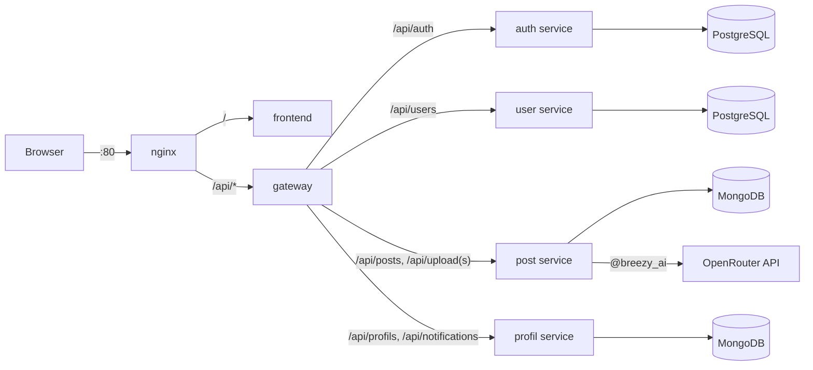

# Breezy: infrastructure and API gateway

Breezy is a Twitter-like social network built as microservices: short posts with images, likes, reposts,
replies, follows, search and notifications, plus an `@breezy_ai` bot that answers when a post mentions it.
Team project at CESI École d'Ingénieurs (distributed applications, June 2026).

This repository ties the services together: the API gateway, the nginx entry point, Docker Compose and a demo
seed.

## Architecture



| Repository | Role | Stack | Port |
|---|---|---|---|
| [breezy-frontend](https://github.com/El-Pouleto-ultimate/breezy-frontend) | web client | Next.js 14, React 18, Tailwind CSS | 3000 |
| **breezy-infra** | gateway, nginx, Docker Compose, seed | Express 4, jsonwebtoken, express-rate-limit | 3000, 80 |
| [breezy-auth-service](https://github.com/El-Pouleto-ultimate/breezy-auth-service) | accounts, JWT and refresh sessions, roles | Express 5, Sequelize, PostgreSQL | 3001 |
| [breezy-user-service](https://github.com/El-Pouleto-ultimate/breezy-user-service) | profiles, search, follows, bans | Express 5, Sequelize, PostgreSQL | 3002 |
| [breezy-post-service](https://github.com/El-Pouleto-ultimate/breezy-post-service) | posts, feed, likes, reposts, comments, uploads, AI bot | Express 5, Mongoose, MongoDB | 3003 |
| [breezy-profil-service](https://github.com/El-Pouleto-ultimate/breezy-profil-service) | public profiles, notifications | Express 5, Mongoose, MongoDB | 3004 |

Each service owns its database. The gateway checks the JWT on protected routes and passes the user's id and
role to the services in `x-user-*` headers; the services call each other with a shared internal secret. Only
nginx is published, on port 80.

## Run it

Requirements: Docker with Docker Compose, and Git. Clone the six repositories side by side:

```bash
mkdir breezy && cd breezy
for r in infra frontend auth-service user-service post-service profil-service; do
  git clone https://github.com/El-Pouleto-ultimate/breezy-$r.git
done
cd breezy-infra
cp .env.example .env      # then replace the change_me values
docker compose up --build
```

Open http://localhost. `docker compose down -v` stops everything and deletes the data. `OPENROUTER_API_KEY` is
optional: without it, the `@breezy_ai` bot stays silent.

## Gateway routes

| Path | Service | JWT |
|---|---|---|
| `/api/auth/me`, `/api/auth/change-password`, `/api/auth/username`, `/api/auth/admin/*` | auth | required |
| other `/api/auth/*` routes: register, login, refresh, logout | auth | no |
| `/api/users/*` | user | required |
| `/api/posts/*`, `/api/upload` | post | required |
| `/api/uploads/*`, the uploaded images | post | no |
| `/api/profils/*`, `/api/notifications/*` | profil | required |
| `/api/health` | gateway | no |

Rate limits: 500 requests per 15 minutes per IP, and 20 per 15 minutes on login and registration.

## Demo data

The `seed` container runs on every `docker compose up` and creates 13 accounts (3 admins, 3 moderators and
7 users), about 30 posts, follows, likes and comments. All accounts share the demo password defined in
`seed/seed.js`, which `SEED_PASSWORD` overrides. Run by hand (`cd seed && npm install && node seed.js`), it also
writes the accounts to `seed/accounts.json`, which Git ignores. Running it twice within 15 minutes hits the login
rate limit.

## Project structure

```
docker-compose.yml   the whole stack: nginx, gateway, frontend, 4 services, 2 PostgreSQL, 2 MongoDB, seed
nginx/               entry point: / to the frontend, /api/ to the gateway
gateway/             Express proxy: JWT check, x-user-* headers, rate limits
seed/                demo accounts and content
```

## Team

[Estebge](https://github.com/Estebge), [haguetm](https://github.com/haguetm),
[Jessica14112005](https://github.com/Jessica14112005), [Tuture57](https://github.com/Tuture57).
